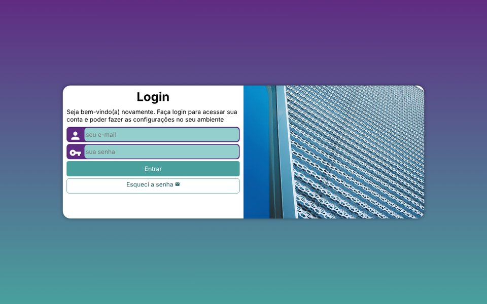
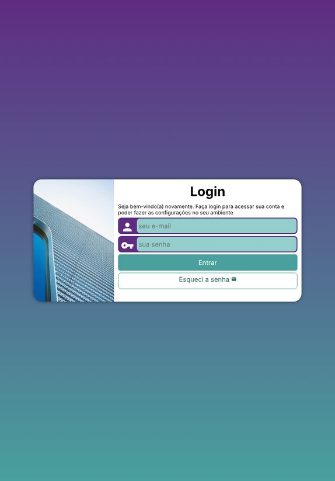
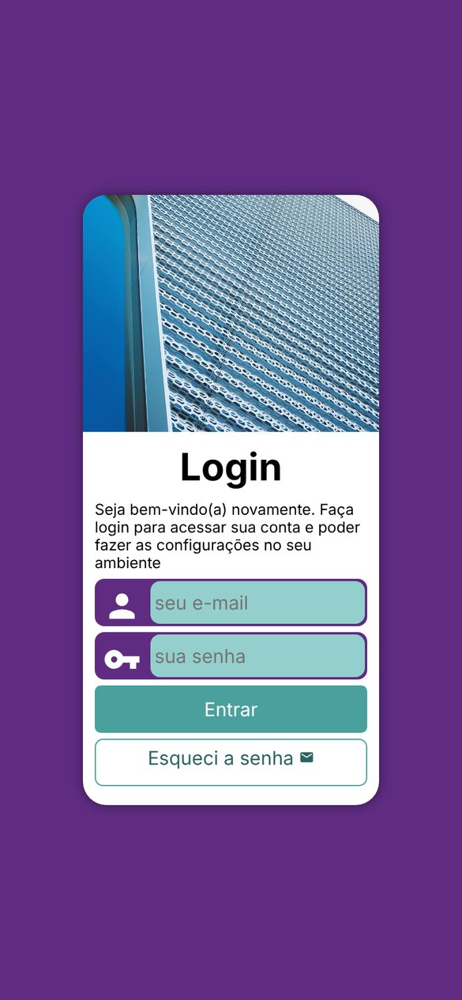

# Login Page

Responsive login screen built with HTML and CSS, with three layouts: phone, tablet and desktop.

**Live page:** [pedrorosszny.github.io/login-page](https://pedrorosszny.github.io/login-page/)

The interface is in Brazilian Portuguese.

## Screenshots

| Desktop | Tablet | Phone |
|---|---|---|
|  |  |  |

## How it works

- The layout is mobile first. [`estilos/style.css`](estilos/style.css) is the phone layout: a 250 px card with the photo on top and the form below. [`estilos/media-query.css`](estilos/media-query.css) adds a tablet layout from 768 px (photo on the left, 30% of the card) and a desktop layout from 992 px (photo on the right, half of the card), both on a purple to teal gradient.
- The card animates its width and height when the window crosses a breakpoint.
- Each field has a Material Icons symbol, and the browser validates them: the login must be an email, and the password must have 8 to 20 characters.

## Limitations

This is a front-end layout study. The form sends to `login.php` and the "Esqueci a senha" link opens `esqueci.html`; neither file is part of this project, so both lead to an error page.

## Running

Open `index.html` in a browser. The icons load from Google Fonts, so they need an internet connection.

## License

The code is released under the [MIT License](LICENSE).

## Author

Pedro Ross. [GitHub](https://github.com/PedroRossZny) | [LinkedIn](https://www.linkedin.com/in/pedro-ross)
